<!-- _class: cover -->
<!-- _paginate: false -->

UNDERGRADUATE PROJECT · 專題成果

<h1>STM32F103 四旋翼飛控系統</h1>

FreeRTOS · Fusion AHRS · 串級 PID nRF24L01P 無線遙測與線上調參

報告人：<em>待補（姓名／系所）</em> 
F450 機架實飛驗證　·　韌體版本 <code>2040300</code> 
github.com/ZHANG-XICHANG/stm32f103-flight-controller

---

## 研究動機

<h3>01　打通飛控全鏈路</h3>

從感測、姿態估測、閉迴路控制到馬達輸出，每一層都自己實作並能解釋，而不是直接套用現成飛控韌體。

<h3>02　低資源 MCU 的即時控制</h3>

STM32F103（72 MHz Cortex-M3）上以 FreeRTOS 排程：感測、控制、無線通訊與狀態顯示需在固定週期內完成。

<h3>03　以資料驅動調參</h3>

串級 PID 調參若只靠目視很難重現。自建遙測鏈路，把每一筆控制內部狀態記錄成 CSV，再用時域與頻域分析。

<h3 style="margin-top:30px">本專題自行實作的範圍</h3>

<b>感測</b>MPU6050 驅動 開機校正

→

<b>姿態估測</b>濾波 + Fusion AHRS

→

<b>控制</b>串級 PID 狀態機

→

<b>致動</b>X 型混控 TIM4 PWM

→

<b>通訊</b>nRF24 封包 失聯保護

→

<b>觀測</b>ACK 遙測 線上調參 GUI

<strong>研究問題：</strong>在 6 ms 控制週期、無磁力計的條件下，如何讓 F450 四旋翼穩定飛行？調參時觀察到的振盪從何而來？

---

## 系統目標與完成狀態

✓Roll / Pitch 角度穩定（串級 PID，搖桿 ±10°）實飛
✓Yaw 角速度控制（單環，搖桿 ±90 °/s）程式碼
✓無線操控、解鎖狀態機、失聯 1000 ms 停機程式碼
✓即時遙測 + 線上 PID 調參（RAM，不需重燒）程式碼
✓F450 機架實際飛行測試影片
✗定高模式 <code>FIX_HEIGHT</code>（目前送出停機指令）未實作
✗絕對航向保持（未使用磁力計）未實作

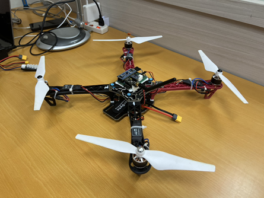

F450 整機（實拍）

<b>6 ms</b>飛控任務週期（≈166.7 Hz）

<b>400 Hz</b>TIM4 四路 ESC PWM

<b>31 B</b>每筆 ACK 遙測快照

<b>6 份</b>實測遙測 CSV（X 軸）

<!-- _footer: '來源：Core/Src/freertos.c:46 · flight.c:270-301, 308-450 · tim.c:45-47 · telemetry.c · docs/data/' -->

---

## 硬體架構

| 元件 | 規格 / 介面 |
| --- | --- |
| 主控 | STM32F103C8T6，72 MHz |
| IMU | MPU6050，**I2C2 400 kHz**，±2000 °/s · ±2 g |
| 無線 | nRF24L01P，**SPI1**，CE PA3 / CSN PA4 |
| 輸出 | **TIM4 CH1–4**（PB6–PB9）→ 4 × ESC |
| 動力 | A2212 KV980 · XRotor 20A · 9450 槳 |
| 電池 | 4S 6200 mAh 90C |
| 機架 | F450，X 型 |
| 操控端 | 自製 STM32F411 遙控器（USB 橋接電腦） |

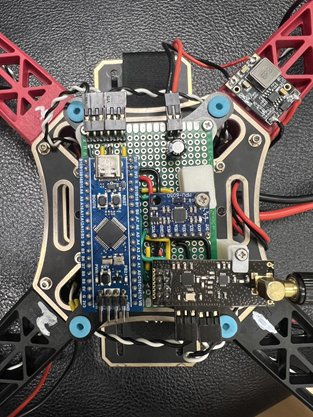
自製飛控板（實拍）

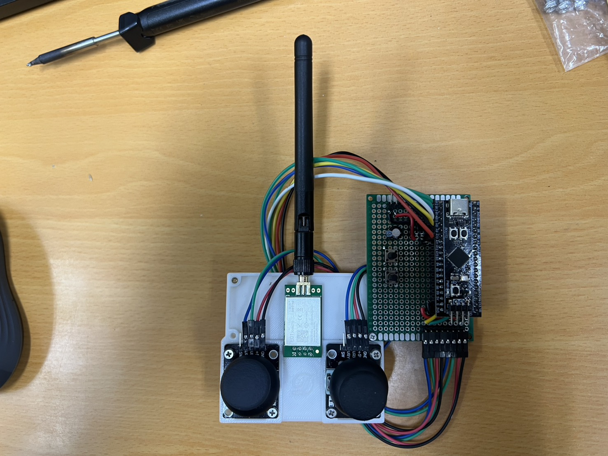
自製遙控器（實拍）

<!-- _footer: '來源：P01_flight_hal.ioc · Core/Src/i2c.c · spi.c · tim.c · README（動力配置由作者提供）' -->

---

## 軟體架構：FreeRTOS 三任務

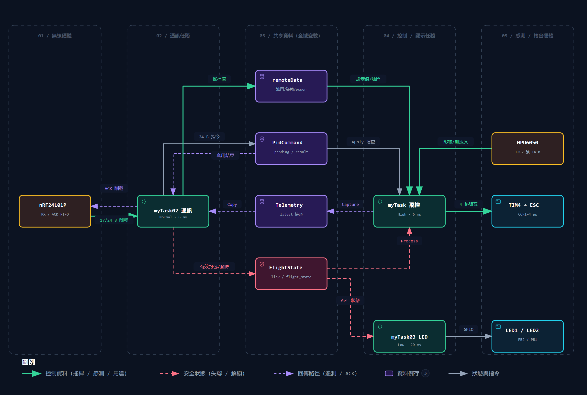
Archify 產生，依原始碼追蹤（深色匯出）

| 任務 | 優先權 | 週期 | 職責 |
| --- | --- | --- | --- |
| 飛控 | High | 6 ms | 狀態機 → 姿態 → PID → 混控 → 遙測快照 |
| 通訊 | Normal | 6 ms | 收封包、驗證、準備 ACK |
| LED | Low | 20 ms | 連線 / 解鎖指示 |

優先權與週期皆為程式設定值，非實測執行時間

全部以 <code>vTaskDelayUntil</code> 固定週期喚醒；<strong>未使用 Queue / Semaphore / Mutex</strong>。

遙測以快照交換；<code>remoteData</code> 仍是共享結構，尚無整包原子快照。

<!-- _footer: '來源：Core/Src/freertos.c:44-83, 150-300' -->

---

## 系統資料流

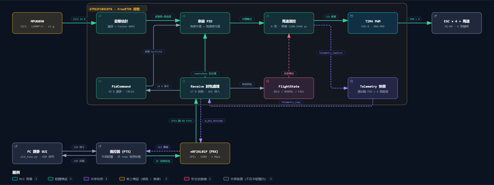

感測 → 姿態估計 → 串級 PID → 混控 → TIM4 PWM → ESC；遙控指令與 PID 命令經 nRF24L01P 進入，遙測快照以 ACK Payload 回傳（Archify 產生，依原始碼）

<!-- _footer: '來源：Core/Src/flight.c · receive.c · pid_command.c · telemetry.c · nRF24L01P.c' -->

---

## 姿態估測：前處理 + Fusion AHRS

<b>MPU6050</b>14 B 連續讀取 °/s · g

→

<b>Gyro 一階低通</b>α = 0.15

→

<b>Accel Kalman</b>Q 0.001 · R 0.534

→

<b>Remap + Bias</b>NWU · 動態零偏

→

<b>Fusion AHRS</b>gain 0.5 · 無磁力計

→

<b>輸出</b>Euler 角 body_rate

$$
y[k] = 0.15\,x[k] + 0.85\,y[k-1],\quad \Delta t = 6\ \text{ms}
$$

推算截止頻率 ≈ <strong>4.3 Hz</strong>；在 4 Hz 時相位落後約 <strong>39°</strong>。

程式碼Fusion：啟動時增益由 10 在 3 s 內降到 0.5；加速度拒絕 10°，逾時 5 s 後恢復；零偏判定 3 °/s、3 s。

內環使用的是<strong>濾波後</strong>角速度——濾波器的相位落後會直接進入控制迴路。

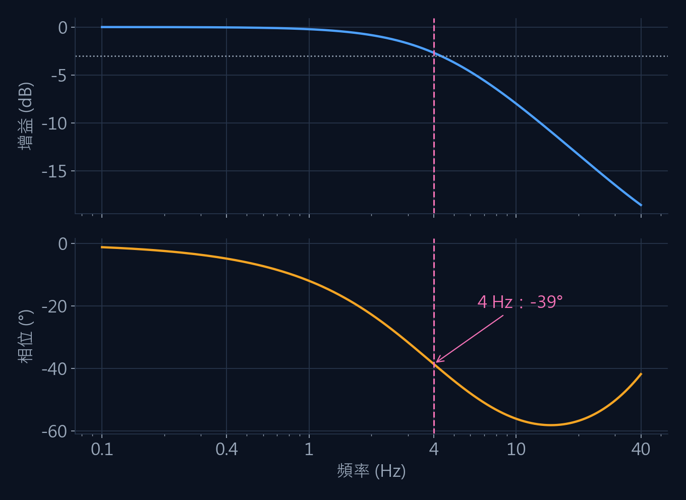
推算Gyro 低通頻率響應（由差分方程計算）

<!-- _footer: '來源：Core/Src/com_filter.c:3-21 · flight.c:155-260 · Middlewares/Third_Party/Fusion/' -->

---

## 串級 PID 控制

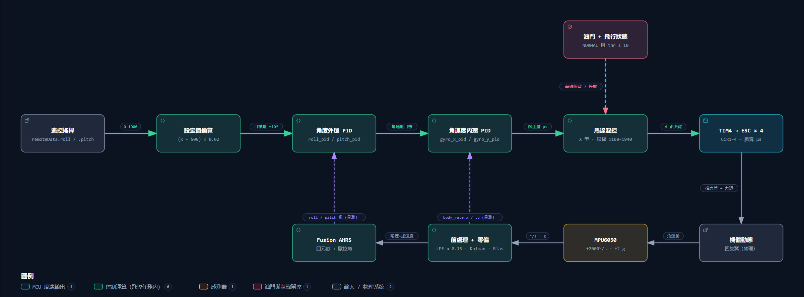
Roll / Pitch 串級控制方塊圖（Archify 產生，依原始碼）

$$
u = K_p e + K_i \!\int\! e\,dt + K_d\,\underbrace{\mathrm{LPF}_{10\,\text{Hz}}\!\left(-\tfrac{dy}{dt}\right)}_{\text{內環：量測值微分}}
$$

外環輸出 = 內環目標角速度（<code>PID_calc_chain</code>）；Yaw 只有角速度單環。

| 控制器 | Kp | Ki | Kd |
| --- | --- | --- | --- |
| Roll / Pitch 角度外環 | 7.0 | 0 | 0.05 |
| Roll / Pitch 角速度內環 | 0.5 | 0 | 0.01 |
| Yaw 角速度 | 2.0 | 0.1 | 0 |

程式碼原始碼預設值，作者確認與實飛影片一致

<!-- _footer: '來源：Core/Src/com_pid.c:6-67 · flight.c:30-85, 270-301' -->

---

## 馬達混控與 ESC PWM

<h3>X 型混控（程式實作）</h3>

$$
\begin{aligned}
M_1 &= T - P - R + Y \\
M_2 &= T - P + R - Y \\
M_3 &= T + P + R + Y \\
M_4 &= T + P - R - Y
\end{aligned}
$$

T：油門 0–1000 線性映射到 1100–1940 µs；P / R / Y：三軸角速度內環輸出。每顆馬達再限幅於 <strong>1100–1940 µs</strong>。

<svg viewBox="0 0 520 210" width="520" height="210" style="margin-top:6px">
  <g stroke="#26344A" stroke-width="10" stroke-linecap="round"><line x1="190" y1="40" x2="330" y2="170"/><line x1="330" y1="40" x2="190" y2="170"/></g>
  <rect x="236" y="80" width="48" height="50" rx="8" fill="#17233A" stroke="#4EA1FF"/>
  <path d="M260 8 l9 14 h-18 z" fill="#4EA1FF"/><text x="282" y="22" fill="#9AA8BA" font-size="15">機頭 +X</text>
  <g font-family="Cascadia Mono,Consolas,monospace" font-size="15" text-anchor="middle">
    <circle cx="190" cy="40" r="30" fill="#111A2B" stroke="#2DD4BF" stroke-width="2"/><text x="190" y="38" fill="#E6EDF6">M1</text><text x="190" y="56" fill="#2DD4BF" font-size="12">CCW</text>
    <circle cx="330" cy="40" r="30" fill="#111A2B" stroke="#F5A524" stroke-width="2"/><text x="330" y="38" fill="#E6EDF6">M2</text><text x="330" y="56" fill="#F5A524" font-size="12">CW</text>
    <circle cx="330" cy="170" r="30" fill="#111A2B" stroke="#2DD4BF" stroke-width="2"/><text x="330" y="168" fill="#E6EDF6">M3</text><text x="330" y="186" fill="#2DD4BF" font-size="12">CCW</text>
    <circle cx="190" cy="170" r="30" fill="#111A2B" stroke="#F5A524" stroke-width="2"/><text x="190" y="168" fill="#E6EDF6">M4</text><text x="190" y="186" fill="#F5A524" font-size="12">CW</text>
  </g>
  <text x="20" y="110" fill="#9AA8BA" font-size="15">← +Y（左）</text>
  <text x="380" y="100" fill="#9AA8BA" font-size="13">俯視；旋向由</text><text x="380" y="118" fill="#9AA8BA" font-size="13">作者確認</text>
</svg>

<h3>TIM4 PWM 設定</h3>

$$
f_\text{PWM} = \frac{72\ \text{MHz}}{(71+1)(2499+1)} = 400\ \text{Hz},\qquad 1\ \text{count} = 1\ \mu\text{s}
$$

<h3 style="margin-top:12px">輸出閘門</h3>
<ul class="small">
<li><code>NORMAL</code> 且油門 ≥ 10 才依混控輸出</li>
<li><code>IDLE</code> / <code>FAIL</code> / <code>FIX_HEIGHT</code>：全部送最低脈寬 1100 µs</li>
<li>PWM 不關閉，停轉行為依 ESC 校準</li>
</ul>

<!-- _footer: '來源：Core/Src/flight.c:118-130, 308-450 · ESC.c:7-79 · tim.c:45-47 · ESC.h:7-8' -->

---

## 無線通訊與遙測

| 封包 | 長度 | 方向 / 內容 |
| --- | --- | --- |
| 控制 | **17 B** | 遙控器 → 飛控：油門、三軸、事件 |
| PID 命令 | **24 B** | 'PI' 標頭 + 增益 + CRC16 |
| 遙測 ACK | **31 B** | 飛控 → 遙控器：所選軸 PID + 4 路 PWM |

程式碼CH40 · 2 Mbps · 0 dBm · 自動重傳 500 µs × 5

程式碼超過 1000 ms 未收到有效封包 → <code>FAIL</code>，馬達送最低脈寬

ACK 為預先載入的上一筆快照，不是本次接收後即時計算的結果。

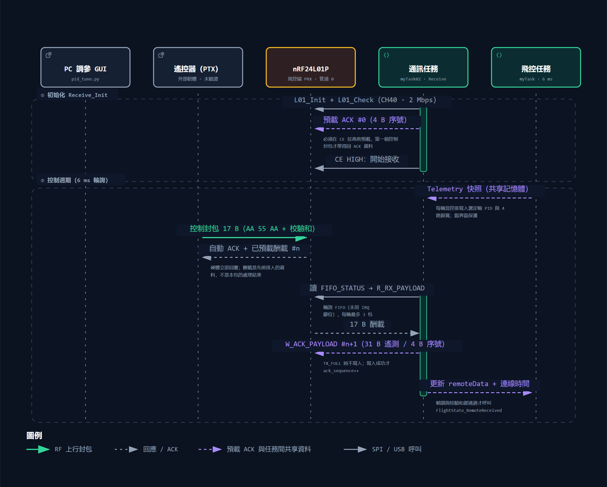
控制封包與 ACK Payload 時序（Archify 產生）

<!-- _footer: '來源：Core/Inc/nRF24L01P.h:42-48 · receive.c:15-140 · pid_command.c · telemetry.c · flight_state.c' -->

---

## 實驗方法

<b>飛控</b>每 6 ms 擷取遙測快照

→

<b>nRF24 ACK</b>31 B payload

→

<b>遙控器</b>USB 轉發

→

<b>電腦</b>serial_scope.py / pid_tune.py

→

<b>CSV 分析</b>時域 · FFT · 增益回推

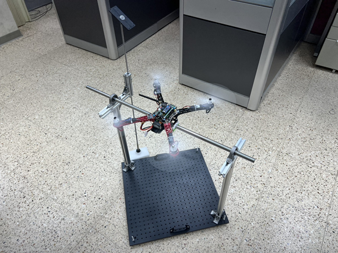
測試架調參（實拍）

<ul class="small">
<li>實測6 份 CSV（2026-09-21 / 22，測試架調參階段），只記錄 <strong>X 軸（Roll）</strong></li>
<li>前處理：去除重複序號；依序號重建 6 ms 等間隔序列，缺口線性內插</li>
<li>頻譜：去平均、Hann 窗、FFT，於 2–10 Hz 取峰值</li>
<li>推算外環 Kp：最小平方擬合 目標角速度 ≈ −k·roll + c；內環 Kp：P 項 ÷ 誤差 中位數</li>
<li>待補測試條件（是否裝槳、油門、電壓、擾動方式）未記錄</li>
</ul>

<!-- _footer: '資料：docs/data/run-*.csv（原始 telemetry*.csv 未修改副本）· 分析腳本：presentations/tools/make-figures.py' -->

---

## 結果分析 ①：擾動後的衰減振盪

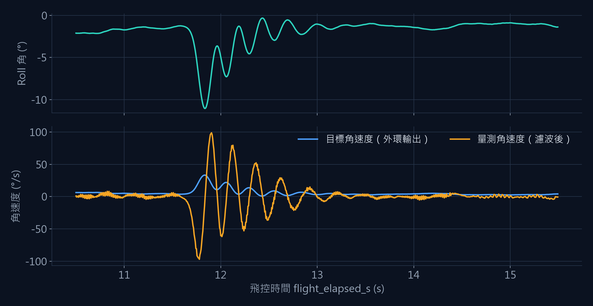
實測telemetry_p_2.3.csv，10.5–15.5 s（未經平滑，只去除重複序號）

<b>98.8</b>角速度峰值 °/s

<b>−11.1°</b>Roll 最大偏移

<b>≈1.1 s</b>回到 |ω| &lt; 15 °/s

<b>≈4 週</b>過零 8 次

<ul class="small">
<li>振盪<strong>逐週期衰減</strong>：內環穩定，但阻尼不足</li>
<li>量測角速度振幅遠大於目標角速度——振盪主要發生在<strong>內環</strong></li>
</ul>

此記錄回推增益：外環 ≈ 3.0、內環 ≈ 2.25（早期調參，與現行原始碼不同）

<!-- _footer: '指標由 CSV 直接計算：擾動起點 11.69 s（|ω| > 20 °/s），最後 |ω| ≥ 15 °/s 於 12.80 s' -->

---

## 結果分析 ②：振盪頻率集中在 3.7–4.5 Hz

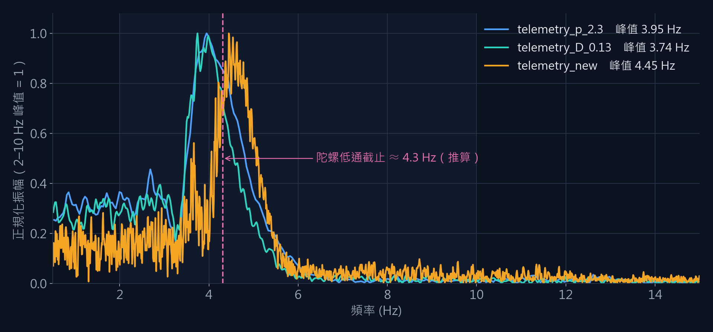
實測gyro_x_deg_s 振幅頻譜（各自以 2–10 Hz 峰值正規化）

| 記錄 | 長度 | 覆蓋率 | 峰值 |
| --- | --- | --- | --- |
| p_2.3 | 21.1 s | 84.0% | **3.95 Hz** |
| D_0.13 | 33.2 s | 87.1% | **3.74 Hz** |
| new | 84.1 s | 92.3% | **4.45 Hz** |

三份小角度擾動記錄的主頻都落在<strong>陀螺低通截止頻率（≈ 4.3 Hz）附近</strong>。

推論濾波相位落後 + 馬達延遲 + D 項低通 + 一個週期計算延遲 → 內環在 4 Hz 附近相位裕度不足。<em>待對照實驗驗證。</em>

<!-- _footer: '另兩份大角度記錄（p_2.33、D_0.12）2–10 Hz 峰值落在 3.6–3.7 Hz，受低頻擺動影響，未列入表格' -->

---

## 問題與改善

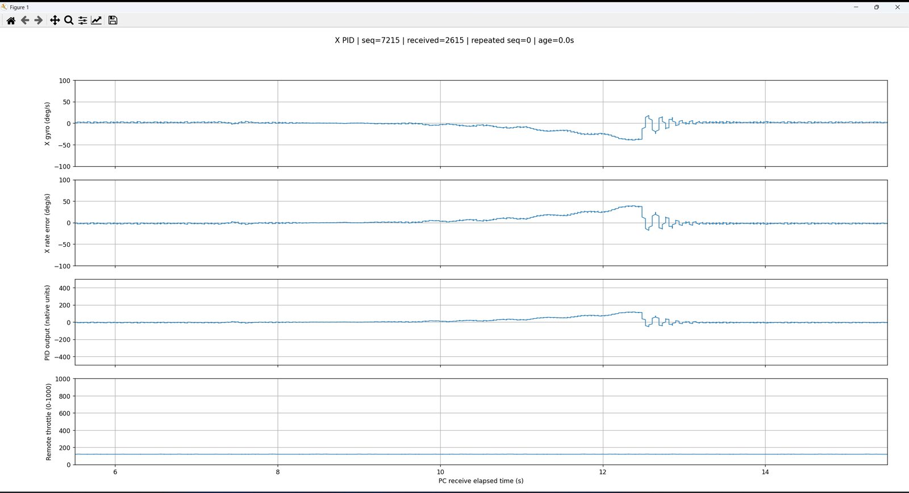
截圖內環 Kp 3：擾動後數次振盪即恢復

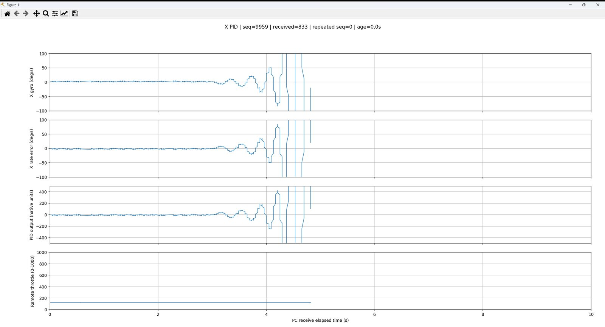
截圖內環 Kp 5：振盪逐週期放大 → 發散

| 觀察到的問題 | 改善方向 |
| --- | --- |
| 4 Hz 振盪、提高 Kp 即發散 | Gyro 截止提高到 20–40 Hz，或改二階低通 / 陷波 |
| 控制率 166.7 Hz | 內環 500 Hz–1 kHz，外環維持低頻 |
| PID 無積分限幅、停機不重置 | Anti-windup、解鎖 / 停機時重置狀態 |
| IMU 讀取失敗沿用舊姿態；校準失敗不阻擋 | 失敗計數 → 進入 <code>FAIL</code> |
| 失聯恢復自動回 <code>NORMAL</code> | 恢復後要求重新解鎖 |
| <code>remoteData</code> 共享無原子快照 | 改為雙緩衝 / 臨界區整包複製 |

左欄為 PID/ 資料夾中的調參工具截圖（舊版 GUI，時間軸為電腦接收時間）

<!-- _footer: '來源：docs/assets/img/tuning/ · Core/Src/com_pid.c · flight.c:190-201 · freertos.c:162-170 · flight_state.c' -->

---

## 結論與未來研究

<h3>結論</h3>
<ul class="small">
<li>在 STM32F103 + FreeRTOS 上完成 <strong>感測 → AHRS → 串級 PID → 混控 → PWM</strong> 全鏈路，並於 F450 實飛</li>
<li>自建 <strong>ACK Payload 遙測 + 線上調參</strong>，讓調參有資料可追溯</li>
<li>實測資料顯示內環存在 <strong>3.7–4.5 Hz</strong> 的衰減振盪，與陀螺低通截止同量級，指出下一步的改善重點</li>
</ul>

<h3 style="margin-top:18px">未來研究</h3>
<ul class="small">
<li>掃頻量測內環開迴路頻率響應，做系統識別與頻域設計</li>
<li>只改變濾波截止頻率的對照實驗，驗證相位裕度推論</li>
<li>比較 PID 與模型為基礎的控制（如 LQR / ADRC）</li>
<li>加入氣壓計 / 磁力計，實作定高與航向保持</li>
</ul>

<h3>待補尚缺的實驗資料</h3>
<ul>
<li>以現行增益（7 / 0.5）錄製的 CSV；現有 CSV 皆為早期增益</li>
<li>Pitch、Yaw 軸遙測（目前只有 X 軸）</li>
<li>步階響應：過衝、上升時間、穩定時間</li>
<li>實飛遙測，以及影片與資料的時間對照</li>
<li>任務執行時間（CPU 負載）與封包遺失率</li>
<li>每次記錄的測試條件（裝槳、油門、電壓、擾動方式）</li>
</ul>

專題網站：zhang-xichang.github.io/stm32f103-flight-controller ・ 實飛影片：youtu.be/hEEcJP3LDC0

